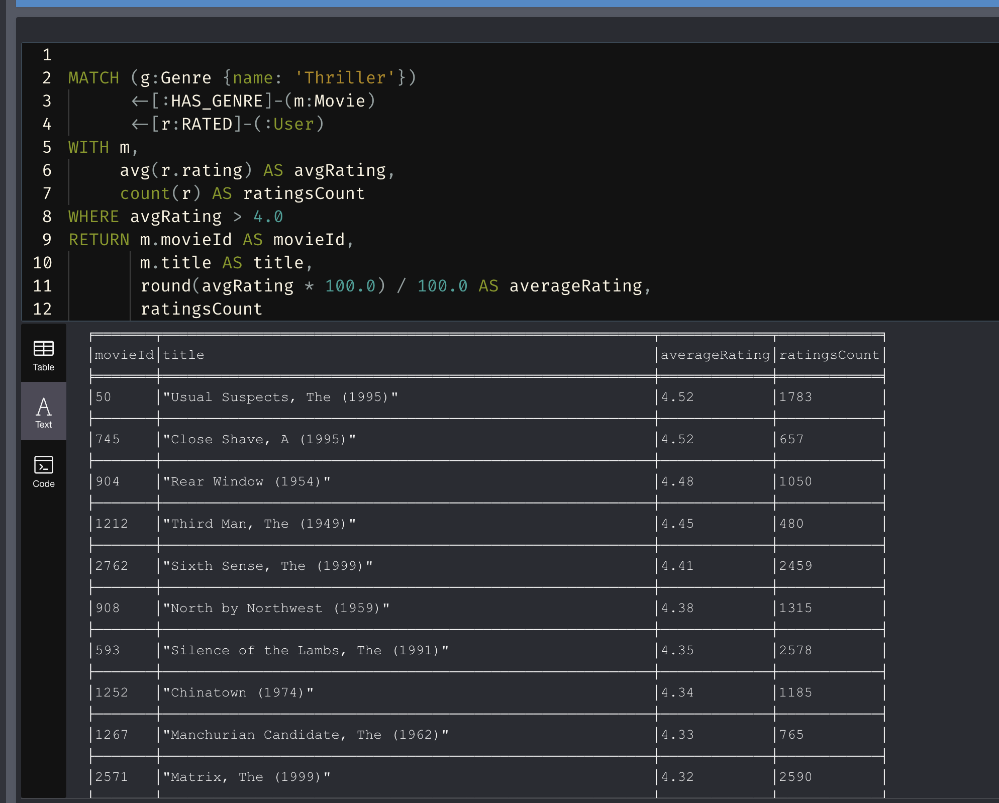
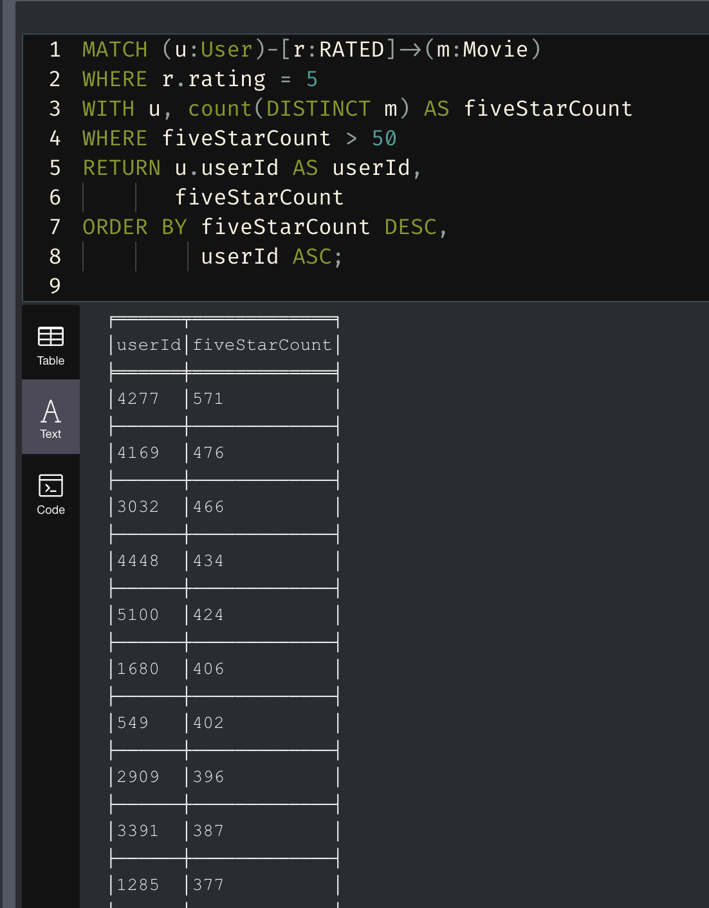
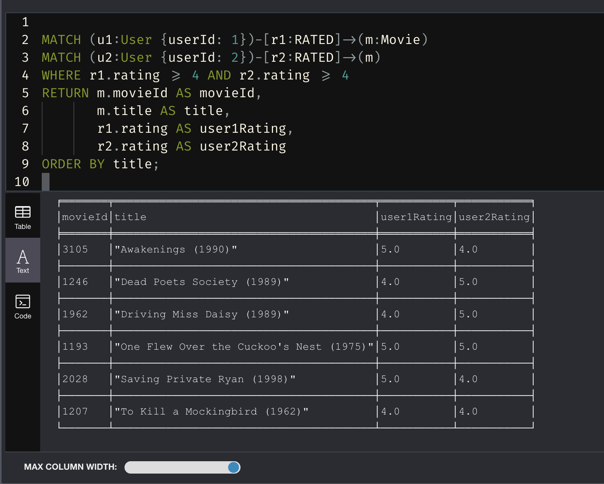
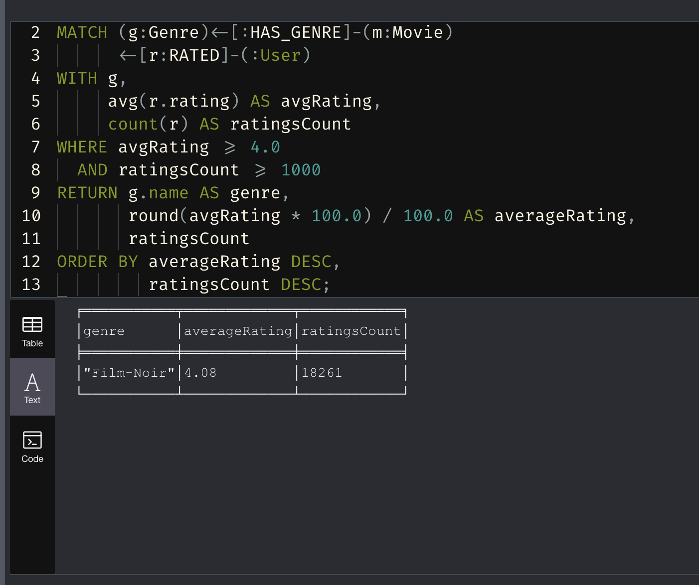
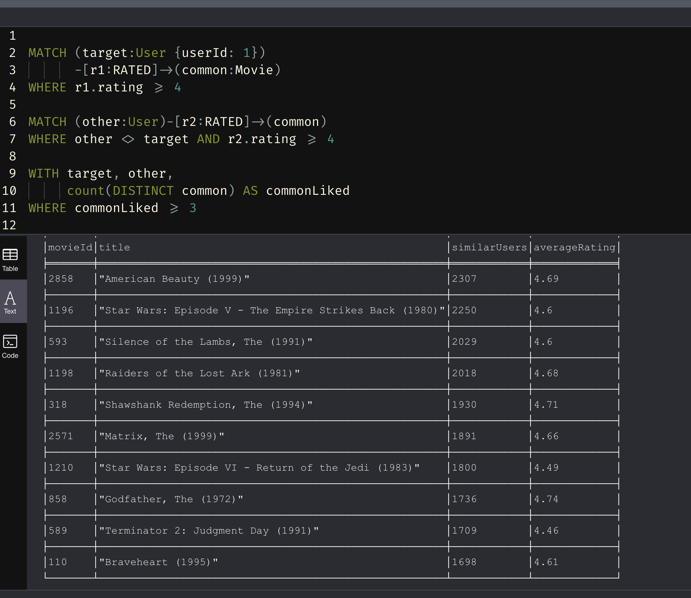
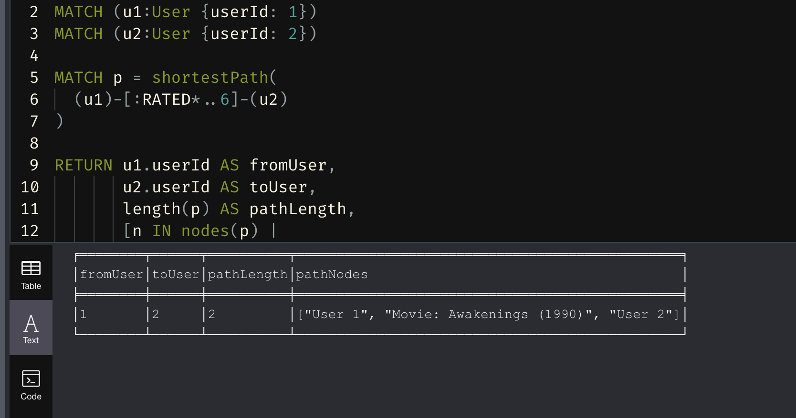
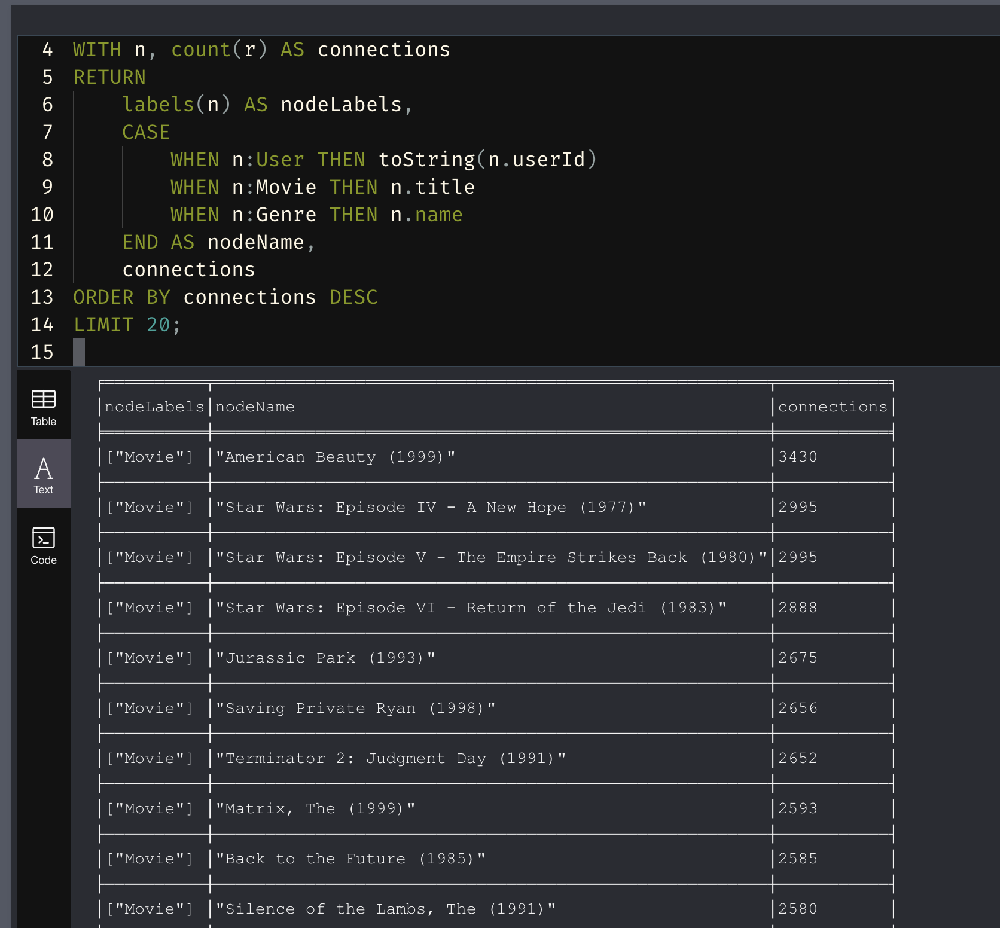
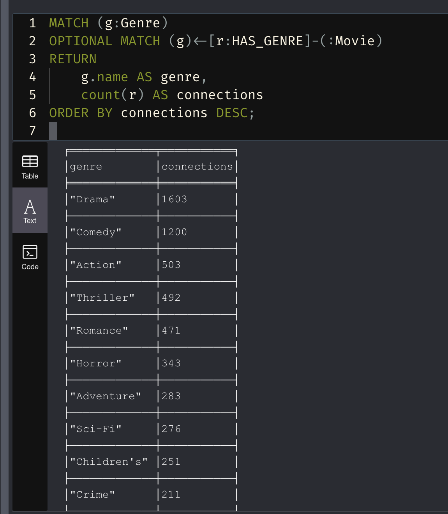
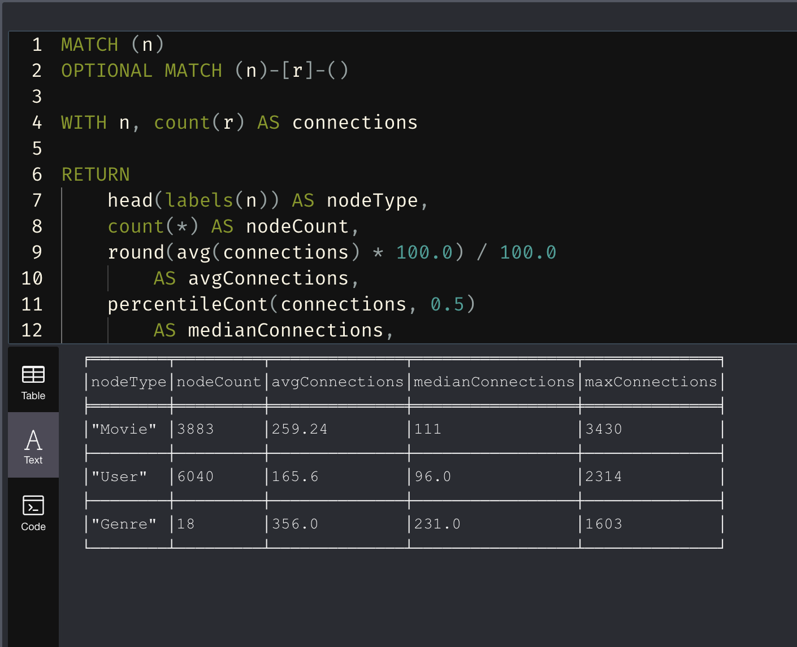

# MovieLens 1M — графова база даних Neo4j

## Частина 1. Проєктування схеми графа

### 1. Обрана модель

Для моделювання набору даних **MovieLens 1M** використовується граф із трьома типами вузлів (`User`, `Movie`, `Genre`) та двома типами спрямованих зв'язків (`RATED`, `HAS_GENRE`). Це дозволяє напряму переходити від користувача до оцінених ним фільмів, а від фільму — до його жанрів.

| Вузол   | Властивості                                                                                                                                       | Джерело                      | Призначення                                      |
| ------- | ------------------------------------------------------------------------------------------------------------------------------------------------- | ---------------------------- | ------------------------------------------------ |
| `User`  | `userId` (ціле число, унікальний ідентифікатор), `gender` (`M` або `F`), `age` (числовий код вікової групи), `occupation` (числовий код професії) | `users.dat`                  | Представляє користувача, який оцінює фільми.     |
| `Movie` | `movieId` (ціле число, унікальний ідентифікатор), `title` (назва), `year` (рік виходу, якщо його можна визначити)                                 | `movies.dat`                 | Представляє конкретний фільм.                    |
| `Genre` | `name` (унікальна назва жанру)                                                                                                                    | поле `Genres` у `movies.dat` | Представляє жанр, спільний для багатьох фільмів. |

У MovieLens 1M значення `age` — це **коди вікових груп, а не точний вік людини**, а `occupation` — **код категорії професії**. У `movies.dat` рік зазвичай міститься в кінці назви у дужках, наприклад `Toy Story (1995)`. Під час майбутнього завантаження можна виділити `year = 1995`, а в `title` залишити `Toy Story`.

| Зв'язок     | Напрямок                        | Властивості                                                                      | Джерело                      | Значення                                       |
| ----------- | ------------------------------- | -------------------------------------------------------------------------------- | ---------------------------- | ---------------------------------------------- |
| `RATED`     | `(User)-[:RATED]->(Movie)`      | `rating` (числова оцінка), `timestamp` (час оцінювання у форматі Unix timestamp) | `ratings.dat`                | Користувач поставив оцінку конкретному фільму. |
| `HAS_GENRE` | `(Movie)-[:HAS_GENRE]->(Genre)` | Немає                                                                            | поле `Genres` у `movies.dat` | Фільм належить до жанру.                       |

Один користувач може оцінити багато фільмів, один фільм може отримати оцінки від багатьох користувачів. Один фільм також може належати до кількох жанрів; жанр об'єднує багато фільмів. Для цієї моделі передбачаємо **не більше одного зв'язку `RATED` для кожної пари користувач–фільм**.

### 2. ASCII-схема графа

```text
(User {userId, gender, age, occupation})
                  |
                  |  RATED {rating, timestamp}
                  v
       (Movie {movieId, title, year})
                  |
                  |  HAS_GENRE
                  v
            (Genre {name})
```

Стрілки показують напрямки зв'язків. Схема відображає **типи** вузлів і зв'язків: у реальному графі один `User` може мати багато вихідних `RATED`, а один `Movie` — багато вихідних `HAS_GENRE`.

Приклад: користувач `User {userId: 1}` поставив фільму `Movie {movieId: 1, title: 'Toy Story', year: 1995}` оцінку через зв'язок `RATED`; фільм пов'язаний з окремими вузлами жанрів `Animation`, `Children's` та `Comedy` через `HAS_GENRE`.

### 3. Які сутності стали вузлами, а які — ребрами? Чому?

**Вузлами** стали `User`, `Movie` і `Genre`, оскільки кожна з цих сутностей має власну ідентичність і може брати участь у багатьох зв'язках. Користувач існує незалежно від конкретної оцінки, фільм може мати багато оцінок і жанрів, а той самий жанр стосується багатьох фільмів.

**Ребрами** стали `RATED` і `HAS_GENRE`, тому що вони виражають відношення між вузлами. `RATED` зберігає характеристики конкретної взаємодії — оцінку та час її створення. `HAS_GENRE` лише фіксує належність фільму до жанру й не потребує власних властивостей. Таке розділення добре відповідає запитам завдання: пошук оцінених фільмів, порівняння смаків користувачів і аналіз жанрів.

### 4. Оцінка: ребро `RATED` чи окремий вузол `Rating`?

**Обраний варіант — ребро `(User)-[:RATED {rating, timestamp}]->(Movie)`.** У цьому датасеті оцінка є властивістю взаємодії між конкретними користувачем і фільмом. Більшість потрібних запитів проходять шлях `User → Movie`, тому зберігати оцінку на цьому зв'язку логічно: граф має менше вузлів, а запити простіші й потребують менше переходів.

**Переваги ребра `RATED`:** компактніша модель, природний однокроковий перехід від користувача до фільму, зручна фільтрація за `rating` і `timestamp`. **Недоліки:** оцінка не має власної вузлової ідентичності; до неї не можна напряму приєднати інші зв'язки. Якщо потрібно описувати історію редагувань оцінки, джерело відгуку, сеанс перегляду або складний контекст події, модель доведеться розширювати.

**Альтернатива — окремий вузол `Rating`:** `(User)-[:MADE]->(Rating {rating, timestamp})-[:FOR_MOVIE]->(Movie)`. Такий підхід дає кожній оцінці самостійну ідентичність і дозволяє зв'язувати її з іншими сутностями, зберігати кілька подій оцінювання та додаткові метадані. Водночас він додає приблизно один вузол на кожен запис оцінки, збільшує кількість ребер і перетворює прямий перехід `User → Movie` на шлях із двох ребер. Це ускладнює типові запити й може збільшити витрати пам'яті та час обходів.

**Висновок:** для MovieLens 1M і запитів цієї роботи краще використати `RATED` як ребро. Окремий вузол `Rating` був би доречнішим, якби оцінки виступали самостійними подіями з багатьма додатковими зв'язками.

### 5. Чому жанри — окремі вузли `Genre`, а не список у `Movie`?

У вихідному файлі жанри записані як текстовий перелік через `|`, наприклад `Animation|Children's|Comedy`. Для графової моделі їх доцільно перетворити на **спільні вузли `Genre`**, до яких під'єднуються всі відповідні фільми.

Це дає змогу легко знаходити всі фільми жанру `Thriller`, переходити від жанру до фільмів і далі до оцінок, а також аналізувати перетин жанрів та інтереси користувачів. Назва жанру зберігається один раз у вузлі, а не повторюється в кожному фільмі; однакові назви жанрів можна контролювати за допомогою унікальності `Genre.name`.

**Альтернативний підхід — `Movie.genres` як список рядків** — простіший і може бути зручнішим, якщо потрібно лише показувати жанри окремого фільму або фільтрувати за належністю до списку. Однак аналіз зв'язків між жанрами, фільмами та користувачами в такій моделі менш природний для графової бази.

**Компроміс:** популярні вузли `Genre` можуть мати дуже велику кількість зв'язків і перетворитися на _супервузли_. Це потенційно уповільнює широкі обходи графа, тому в наступних частинах роботи їхню кількість зв'язків і вплив на продуктивність слід дослідити окремо.

### 6. Унікальність та логіка майбутнього завантаження

Щоб не створювати дублікати при повторному імпорті, передбачаємо унікальність ключів `User.userId`, `Movie.movieId` і `Genre.name`. Дані із трьох файлів `.dat` будуть перетворені на CSV на наступному етапі. Під час завантаження використаємо `MERGE` для вузлів і зв'язків, а також індекси або обмеження унікальності для пошуку вузлів за їхніми ключами. **У частині 1 описано проєкт схеми; реалізацію імпорту наведено нижче в частині 2.**

### Приклад візуалізації графа в Neo4j Browser


## Частина 2. Завантаження даних

### 1. Підготовка даних

**Використовується MovieLens 1M**, а не MovieLens Latest Small. Вихідні дані — `movies.dat`, `ratings.dat`, `users.dat` із роздільником `::` та кодуванням Latin-1 (ISO-8859-1). Вони розташовані в `import/ml-1m/`.

Структура проєкту після підготовки:

```text
home_work_3/
├── docker-compose.yml
├── convert.py
├── part2_load.cypher
├── README.md
└── import/
    ├── ml-1m/
    │   ├── movies.dat
    │   ├── ratings.dat
    │   ├── users.dat
    │   └── README
    ├── movies.csv
    ├── ratings.csv
    └── users.csv
```

Для конвертації із **кореня проєкту** виконати:

```bash
python convert.py
```

На Windows, якщо команда `python` не розпізнається, можна використати `py convert.py`, а на Linux/macOS — `python3 convert.py`.

Скрипт `convert.py` використовує стандартний модуль `csv`, читає вихідні `.dat` у Latin-1, розділяє поля за `::`, записує CSV з комою та кодуванням UTF-8. Він автоматично знаходить шляхи відносно місця розташування самого скрипту, тому переміщувати `.dat` до кореня проєкту **не потрібно**. Для `users.csv` поле ZIP-коду навмисно пропущено, оскільки його немає у вибраній графовій схемі. `csv.writer` коректно екранує коми та лапки в назвах фільмів. Повторний запуск конвертації перезаписує вихідні CSV.

| Файл                 | Заголовки CSV                     | Призначення                                 |
| -------------------- | --------------------------------- | ------------------------------------------- |
| `import/users.csv`   | `userId,gender,age,occupation`    | Вузли `User`                                |
| `import/movies.csv`  | `movieId,title,genres`            | Вузли `Movie`, `Genre`, зв'язки `HAS_GENRE` |
| `import/ratings.csv` | `userId,movieId,rating,timestamp` | Зв'язки `RATED`                             |

У Docker Compose папка `./import` змонтована як `/var/lib/neo4j/import`, тому Neo4j читає `import/users.csv` за адресою `file:///users.csv`. Кодування UTF-8 дає змогу коректно зчитувати текст у Neo4j.

### 2. Обмеження унікальності та індекси

У файлі **`part2_load.cypher`** спочатку створюються обмеження унікальності за `User.userId`, `Movie.movieId` і `Genre.name` (через `CREATE CONSTRAINT ... IF NOT EXISTS`). Кожне таке обмеження автоматично створює індекс RANGE, тому окремі дублюючі індекси за цими ключами **не потрібні**. Це забезпечує швидкий пошук вузлів під час `MERGE` і `MATCH`, а також запобігає дублям із тим самим ключем.

Додатково створюються `movie_year_idx` і `user_age_idx` для можливих запитів із фільтрацією за роком фільму та віковою групою користувача. Їхня користь залежатиме від конкретних запитів; для створення ребер головними є саме індекси на ідентифікаторах.

Всі обмеження й індекси створюються **до завантаження вузлів та ребер**. Конструкція `IF NOT EXISTS` дає змогу повторно виконувати ці команди без помилки через уже наявний об'єкт схеми.

### 3. Завантаження вузлів `User`

```cypher
LOAD CSV WITH HEADERS FROM 'file:///users.csv' AS row
MERGE (u:User {userId: toInteger(row.userId)})
SET u.gender = row.gender,
    u.age = toInteger(row.age),
    u.occupation = toInteger(row.occupation);
```

`LOAD CSV WITH HEADERS` читає стовпці за назвами. `toInteger` перетворює числові рядки у відповідний тип Neo4j (для `age` це **код вікової групи**, а не точний вік). `MERGE` знаходить користувача за ключем або створює його, якщо ще немає. `SET` оновлює решту властивостей, тому повторне виконання не створює дублікати вузлів.

### 4. Завантаження вузлів `Movie`

Другий блок імпорту читає `movies.csv` і створює `Movie` за унікальним `movieId`. Він перевіряє, чи закінчується оригінальна назва шаблоном `(YYYY)`, наприклад `Toy Story (1995)`. Якщо так, у властивість `title` записується `Toy Story`, а в `year` — число `1995`; якщо ні, назва зберігається без змін, а рік залишається відсутнім. Для перевірки використовується регулярний вираз `.*[(][0-9]{4}[)]$` (дужки позначені символьними класами, щоб уникнути зайвого екранування). Як і для користувачів, `MERGE` не створює дублікати за ідентифікатором, а `SET` оновлює назву та рік.

### 5. Завантаження вузлів `Genre` і ребер `HAS_GENRE`

Третій блок читає `movies.csv` повторно та використовує `UNWIND split(row.genres, '|')`, щоб розкласти перелік жанрів на окремі значення. `MATCH` знаходить уже завантажений фільм за `movieId`; `MERGE (g:Genre {name: genreName})` створює кожен жанр лише один раз, а `MERGE (m)-[:HAS_GENRE]->(g)` пов'язує з ним фільм без повторних зв'язків при повторному запуску. Завдяки цьому той самий вузол жанру може бути пов'язаний із багатьма фільмами.

### 6. Завантаження ребер `RATED` через APOC

`ratings.csv` містить **1 000 209 рядків оцінок** у повному MovieLens 1M, тому для їхнього завантаження використовується `apoc.periodic.iterate`. Перший Cypher-аргумент зчитує рядки CSV, другий виконується для кожної порції записів: за `userId` і `movieId` через `MATCH` знаходяться наявні вузли, а `MERGE (u)-[r:RATED]->(m)` створює рівно один зв'язок між цією парою, якщо такого зв'язку ще немає. `SET` записує числові значення `rating` і `timestamp`; timestamp зберігається як Unix timestamp у секундах.

Налаштування `{batchSize: 5000, parallel: false, retries: 1}` означають, що кожна транзакція обробляє 5000 записів, батчі виконуються послідовно, а при збої можлива одна повторна спроба. Пакетність знижує навантаження на пам'ять порівняно з однією великою транзакцією. `parallel: false` обрано для стабільності: паралельні транзакції можуть конкурувати за ті самі вузли/зв'язки та спричиняти блокування або конфлікти. Хоча тут використовуються `MATCH` для вузлів, послідовна обробка безпечніша для навчального імпорту, де важливі повторюваність і відсутність конфліктів. Результат процедури повертає `batches`, `total`, `failedBatches`, `failedOperations`, `errorMessages`, `wasTerminated`; **перед перевіркою підсумкових кількостей потрібно переконатися, що немає помилок**.

`MERGE` запобігає дублюванню при повторному запуску на тих самих даних за умови, що початковий граф не містить дублікатів зв'язків. `MERGE` сам собою не видаляє дублікати, створені раніше іншим скриптом.

### 7. Виконання запитів і перевірка результатів

1. Запустити `python convert.py` і пересвідчитися, що три CSV-файли створено у `import/`.
2. Відкрити Neo4j Browser: `http://localhost:7474` і під'єднатися до локальної бази.
3. Відкрити `part2_load.cypher` у редакторі та **виконувати кожен завершений запит окремо в наведеному порядку**: обмеження/індекси → `User` → `Movie` → `Genre` і `HAS_GENRE` → `RATED` → перевірка. Не запускати всі запити одним великим блоком транзакції.
4. Після `apoc.periodic.iterate` упевнитися, що `failedBatches = 0`, `failedOperations = 0` і `wasTerminated = false`.
5. Виконати контрольні підрахунки:

```cypher
MATCH (u:User) RETURN count(u) AS users;
MATCH (m:Movie) RETURN count(m) AS movies;
MATCH ()-[r:RATED]->() RETURN count(r) AS ratings;
```

Для **повного, незміненого MovieLens 1M** очікуються такі кількості:

| Що рахуємо | Очікуване значення |
| ---------- | -----------------: |
| `User`     |              6 040 |
| `Movie`    |              3 883 |
| `Genre`    |                 18 |
| `RATED`    |          1 000 209 |

У файлі `part2_load.cypher` також є перевірка кількості вузлів `Genre`, ребер `HAS_GENRE` і приклад читання кількох оцінок.

**Статус:** код підготовлено для локального запуску. Реальні результати імпорту та скриншоти з Neo4j Browser слід додати після виконання на власному комп'ютері; вони не вигадуються наперед.

---

## Частина 3. Запити різної складності

### Мета роботи

Метою цієї частини є практичне використання мови Cypher для виконання аналітичних запитів різної складності до графової бази даних MovieLens 1M.

Усі шість запитів збережено у файлі `queries/part3.cypher`. Результати отримано в Neo4j Browser, а скріншоти розміщено в папці `results/part_3/`.

### Запит 1. Фільми жанру Thriller із середнім рейтингом вище 4.0

**Завдання:** знайти фільми жанру `Thriller`, середній рейтинг яких перевищує 4.0.

**Пояснення запиту:**

Запит використовує `MATCH` для переходу від вузла `Genre` з назвою `Thriller` через зв'язок `HAS_GENRE` до фільмів `Movie`, а потім через `RATED` — до оцінок користувачів.

Функція `avg(r.rating)` обчислює середній рейтинг кожного фільму, а `count(r)` — кількість отриманих оцінок.

Після групування через `WITH` застосовується фільтр `WHERE avgRating > 4.0`. Результати сортуються за середнім рейтингом, кількістю оцінок та назвою фільму.

**Фактичний результат:**

Знайдено **52 фільми**, що відповідають заданій умові.

Найвищі результати:

| Фільм                      | Середній рейтинг | Кількість оцінок |
| -------------------------- | ---------------: | ---------------: |
| Usual Suspects, The (1995) |             4.52 |             1783 |
| Close Shave, A (1995)      |             4.52 |              657 |
| Rear Window (1954)         |             4.48 |             1050 |

**Висновок:** графова модель дозволяє знаходити фільми конкретного жанру й обчислювати їхні агреговані рейтинги. Кількість оцінок допомагає оцінити, наскільки репрезентативним є середній рейтинг.

**Скріншот:** `results/part_3/1.png`



### Запит 2. Користувачі, які поставили оцінку 5 більш ніж 50 фільмам

**Завдання:** знайти користувачів, які поставили максимальну оцінку більш ніж 50 різним фільмам.

**Пояснення запиту:**

Через `MATCH (u:User)-[r:RATED]->(m:Movie)` знаходяться оцінки користувачів.

Умова `WHERE r.rating = 5` залишає лише максимальні оцінки. Функція `count(DISTINCT m)` підраховує кількість різних фільмів, яким кожен користувач поставив оцінку 5.

Після групування виконується фільтрація `WHERE fiveStarCount > 50`. Результати сортуються за спаданням кількості таких оцінок.

**Фактичний результат:**

Запит успішно повернув користувачів, які відповідають умові. Серед отриманих записів є користувач із `userId = 235`, який поставив оцінку 5 для **170 фільмів**.

**Висновок:** запит дозволяє визначати користувачів, які часто виставляють максимальні оцінки. Це може бути корисним для подальшого аналізу користувацької активності та особливостей оцінювання.

**Скріншот:** `results/part_3/2.png`



### Запит 3. Фільми, які два користувачі оцінили високо

**Завдання:** знайти фільми, яким користувачі `userId = 1` і `userId = 2` поставили оцінки не нижче 4.

**Пояснення запиту:**

Використано два шаблони `MATCH`, які шукають зв'язки `RATED` від двох користувачів до одного й того самого вузла `Movie`.

Спільна змінна `m` гарантує, що перевіряються оцінки одного фільму.

Умова `WHERE r1.rating >= 4 AND r2.rating >= 4` залишає тільки фільми, які обидва користувачі оцінили високо.

**Фактичний результат:**

Знайдено **6 спільних високо оцінених фільмів**.

| Фільм                                  | User 1 | User 2 |
| -------------------------------------- | -----: | -----: |
| Awakenings (1990)                      |      5 |      4 |
| Dead Poets Society (1989)              |      4 |      5 |
| Driving Miss Daisy (1989)              |      4 |      5 |
| One Flew Over the Cuckoo's Nest (1975) |      5 |      5 |
| Saving Private Ryan (1998)             |      5 |      4 |
| To Kill a Mockingbird (1962)           |      4 |      4 |

**Висновок:** користувачі №1 та №2 мають щонайменше шість спільних фільмів, які обидва оцінили високо. Це може свідчити про подібність їхніх кінематографічних уподобань.

**Скріншот:** `results/part_3/3.png`



### Запит 4. Жанри з високими середніми оцінками

**Завдання:** визначити жанри, фільми яких отримують високі середні оцінки, та підрахувати кількість оцінок.

**Пояснення запиту:**

Через `HAS_GENRE` та `RATED` знаходяться оцінки фільмів кожного жанру.

Функція `avg(r.rating)` обчислює середню оцінку жанру, а `count(r)` — загальну кількість оцінок фільмів цього жанру.

Для аналізу встановлено два критерії:

- Середній рейтинг не нижче 4.0.
- Кількість оцінок не менше 1000.

Другий критерій потрібний, щоб виключити жанри з надто малою кількістю оцінок. Проте він не гарантує, що кожен окремий фільм жанру має високий рейтинг.

**Фактичний результат:**

| Жанр      | Середній рейтинг | Кількість оцінок |
| --------- | ---------------: | ---------------: |
| Film-Noir |             4.08 |            18261 |

Установленим умовам відповідає **один жанр — Film-Noir**.

**Висновок:** жанр Film-Noir має найвищий середній рейтинг серед жанрів, які пройшли встановлені фільтри. Результат показує високу загальну оцінку фільмів жанру, але не доводить однаково високих рейтингів усіх його фільмів.

**Скріншот:** `results/part_3/4.png`



### Запит 5. Рекомендації фільмів на основі схожих смаків

**Завдання:** для користувача `userId = 1` знайти фільми, які він ще не оцінював, але які високо оцінили користувачі зі схожими вподобаннями.

**Пояснення запиту:**

Спочатку визначаються фільми, яким користувач №1 поставив оцінку не нижче 4.

Далі знаходяться інші користувачі, які також високо оцінили ці фільми. Критерієм схожості обрано наявність щонайменше трьох спільних високо оцінених фільмів (`commonLiked >= 3`).

Після цього знаходяться фільми, які схожі користувачі оцінили не нижче 4.

За допомогою `NOT EXISTS` виключаються фільми, які користувач №1 уже оцінював.

Для кожного кандидата підраховуються кількість схожих користувачів, які високо оцінили фільм, та середня оцінка серед цих користувачів. Результати сортуються за кількістю таких користувачів і рейтингом. `LIMIT 10` залишає десять рекомендацій.

**Фактичний результат:**

Отримано 10 рекомендованих фільмів. Перші п'ять:

| Фільм                            | Схожих користувачів | Середній рейтинг |
| -------------------------------- | ------------------: | ---------------: |
| American Beauty (1999)           |                2307 |             4.69 |
| Star Wars: Episode V (1980)      |                2250 |             4.60 |
| Silence of the Lambs, The (1991) |                2029 |             4.60 |
| Raiders of the Lost Ark (1981)   |                2018 |             4.68 |
| Shawshank Redemption, The (1994) |                1930 |             4.71 |

**Висновок:** графова база даних дозволяє побудувати просту рекомендаційну систему за принципом collaborative filtering. Рекомендації формуються на основі спільних позитивних оцінок користувачів, а не лише жанрів фільмів.

У датасеті немає окремої інформації про факт перегляду, тому запит визначає саме фільми, які користувач ще не оцінював.

**Скріншот:** `results/part_3/5.png`



### Запит 6. Найкоротший шлях між двома користувачами

**Завдання:** знайти найкоротший шлях між користувачами `userId = 1` та `userId = 2` через спільні фільми.

**Пояснення запиту:**

Спочатку через `MATCH` знаходяться вузли двох користувачів.

Функція `shortestPath()` шукає найкоротший шлях між ними через зв'язки `RATED`. Напрямок ребер під час обходу ігнорується, оскільки користувачі мають спрямовані зв'язки до фільмів.

Обмеження `*..6` задає максимальну довжину пошуку — шість ребер.

Функція `length(p)` повертає кількість ребер у знайденому шляху, а `nodes(p)` дозволяє отримати послідовність вузлів.

**Фактичний результат:**

- Початковий користувач: 1.
- Кінцевий користувач: 2.
- Довжина найкоротшого шляху: **2**.
- Проміжний вузол: `Movie: Awakenings (1990)`.

Знайдений шлях:

`User 1 → Awakenings (1990) → User 2`

Цей шлях підтверджує, що два користувачі оцінювали один спільний фільм. Функція повернула один із можливих найкоротших шляхів.

**Відповіді на обов'язкові питання**

**1. Що означає довжина шляху?**

Довжина шляху — це кількість зв'язків (ребер), які необхідно пройти, щоб перейти від одного користувача до іншого через вузли фільмів.

У нашій моделі користувачі пов'язані з фільмами через `RATED`, тому шлях між різними користувачами складається з пар переходів через фільми.

**2. Що означає шлях довжиною 2?**

Шлях довжиною 2 означає, що два користувачі оцінили один і той самий фільм.

Приклад:

`User 1 → Movie → User 2`

У виконаному запиті таким фільмом виявився `Awakenings (1990)`.

**3. Як інтерпретувати шляхи довжиною 4 та 6?**

Шлях довжиною 4 означає, що між початковим і кінцевим користувачами є один проміжний користувач і два фільми:

`User A → Movie 1 → User B → Movie 2 → User C`

Користувачі A та C пов'язані опосередковано через користувача B, який оцінював фільми, спільні з кожним із них.

Шлях довжиною 6 містить двох проміжних користувачів і три фільми:

`User A → Movie 1 → User B → Movie 2 → User C → Movie 3 → User D`

Такий шлях демонструє більш віддалений зв'язок між користувачами через послідовність спільно оцінених фільмів.

Чим коротший шлях, тим менше проміжних зв'язків потрібно пройти. Проте сама довжина шляху не гарантує схожості вподобань, оскільки зв'язок `RATED` може містити як високі, так і низькі оцінки.

**Висновок:** у виконаному запиті знайдено найкоротший шлях довжиною 2. Користувачі №1 та №2 безпосередньо пов'язані через спільно оцінений фільм.

**Скріншот:** `results/part_3/6.png`



### Загальний висновок до частини 3

У ході виконання частини 3 розроблено та перевірено шість Cypher-запитів різної складності до бази даних MovieLens 1M.

Базові запити дозволили знаходити фільми за жанрами та середнім рейтингом, а також аналізувати користувачів за кількістю максимальних оцінок.

Запити середнього рівня продемонстрували можливості пошуку спільних високо оцінених фільмів двох користувачів та обчислення агрегованих рейтингів жанрів.

Складні запити показали, як на основі графової структури можна створювати персоналізовані рекомендації й знаходити найкоротші шляхи між користувачами.

Усі шість запитів виконано в Neo4j Browser, отримано результати та підготовлено скріншоти для документації. Графова модель дозволяє природно представляти взаємозв'язки між користувачами, фільмами та жанрами, що особливо корисно для багатокрокових обходів і рекомендаційних задач.

---

## Частина 4. Виявлення супервузлів

### Мета роботи

Метою цієї частини є виявлення супервузлів у графовій базі даних MovieLens 1M, аналіз кількості їхніх зв'язків та визначення можливих проблем із продуктивністю.

Супервузол (supernode) — це вузол графа, що має аномально велику кількість зв'язків порівняно з іншими вузлами.

Для дослідження використано чотири Cypher-запити, які збережено у файлі `queries/part4_supernodes.cypher`. Результати виконання запитів збережено у папці `results/part_4/`.

### Запит 1. Пошук вузлів із найбільшою кількістю зв'язків

**Завдання:** знайти 20 вузлів із найбільшою кількістю зв'язків незалежно від їхнього типу.

**Пояснення запиту:**

За допомогою `MATCH (n)` знаходяться всі вузли графа. `OPTIONAL MATCH (n)-[r]-()` визначає всі зв'язки кожного вузла незалежно від напрямку.

Функція `count(r)` підраховує кількість зв'язків. `labels(n)` визначає тип вузла, а `CASE` повертає відповідний ідентифікатор або назву.

Результати сортуються через `ORDER BY connections DESC`, а `LIMIT 20` залишає двадцять вузлів із найбільшим ступенем.

**Фактичний результат:**

Найбільшу кількість зв'язків мають популярні фільми.

| Фільм                                                 | Кількість зв'язків |
| ----------------------------------------------------- | -----------------: |
| American Beauty (1999)                                |               3430 |
| Star Wars: Episode IV - A New Hope (1977)             |               2995 |
| Star Wars: Episode V - The Empire Strikes Back (1980) |               2995 |
| Star Wars: Episode VI - Return of the Jedi (1983)     |               2888 |
| Jurassic Park (1993)                                  |               2675 |

Кількість зв'язків фільму враховує як вхідні `RATED`, так і вихідні `HAS_GENRE`.

**Висновок:** вузол `American Beauty (1999)` є основним кандидатом на супервузол серед фільмів, оскільки має 3430 зв'язків.



### Запит 2. Аналіз жанрових супервузлів

**Завдання:** визначити жанри, з якими пов'язана найбільша кількість фільмів.

**Пояснення запиту:**

Запит знаходить вузли `Genre` та підраховує кількість вхідних зв'язків `HAS_GENRE`, які ведуть від фільмів до жанру.

За допомогою `ORDER BY connections DESC` жанри сортуються від найбільш поширених до найменш поширених.

**Фактичний результат:**

| Жанр       | Кількість зв'язків |
| ---------- | -----------------: |
| Drama      |               1603 |
| Comedy     |               1200 |
| Action     |                503 |
| Thriller   |                492 |
| Romance    |                471 |
| Horror     |                343 |
| Adventure  |                283 |
| Sci-Fi     |                276 |
| Children's |                251 |

Найбільше зв'язків має жанр `Drama` — 1603, на другому місці `Comedy` — 1200.

**Висновок:** жанри також можуть бути супервузлами. Особливо це стосується `Drama` та `Comedy`, до яких належить велика кількість фільмів.



### Запит 3. Статистика кількості зв'язків за типами вузлів

**Завдання:** порівняти середню, медіанну та максимальну кількість зв'язків між різними типами вузлів.

**Пояснення запиту:**

Спочатку визначається кількість зв'язків кожного вузла. Потім вузли групуються за типами `Movie`, `User` та `Genre`.

Використовуються такі агрегатні функції:

- `count(*)` — кількість вузлів певного типу.
- `avg()` — середня кількість зв'язків.
- `percentileCont(..., 0.5)` — медіана кількості зв'язків.
- `max()` — найбільша кількість зв'язків.

Медіана дозволяє порівняти типовий вузол із вузлами, які мають аномально велику кількість ребер.

**Фактичний результат:**

| Тип вузла | Кількість вузлів | Середня кількість зв'язків | Медіана | Максимум |
| --------- | ---------------: | -------------------------: | ------: | -------: |
| Movie     |             3883 |                     259.24 |     111 |     3430 |
| User      |             6040 |                     165.60 |      96 |     2314 |
| Genre     |               18 |                     356.00 |     231 |     1603 |

**Аналіз:**

Максимальний ступінь вузла `Movie` приблизно у 31 раз перевищує медіану. Для `User` це перевищення становить приблизно 24 рази, а для `Genre` — приблизно 7 разів.

Це підтверджує нерівномірність розподілу зв'язків і наявність вузлів із надзвичайно великим ступенем.



### Запит 4. Користувачі з найбільшою кількістю оцінок

**Завдання:** знайти користувачів, які оцінили найбільше фільмів.

**Пояснення запиту:**

Запит використовує шаблон `(u:User)-[r:RATED]->(:Movie)` для пошуку зв'язків оцінювання.

Після групування за користувачем `count(r)` визначає кількість поставлених оцінок.

Результати сортуються за спаданням, а `LIMIT 10` повертає десять користувачів із найбільшою активністю.

**Фактичний результат:**

| userId | Кількість зв'язків |
| ------ | -----------------: |
| 4169   |               2314 |
| 1680   |               1850 |
| 4277   |               1743 |
| 1941   |               1595 |
| 1181   |               1521 |
| 889    |               1518 |
| 3618   |               1344 |
| 2063   |               1323 |
| 1150   |               1302 |
| 1015   |               1286 |

**Висновок:** найбільший ступінь серед користувачів має `User 4169` — 2314 зв'язків `RATED`. Він є основним кандидатом на супервузол серед користувачів.


### Відповіді на обов'язкові питання

#### 1. Які вузли виявилися супервузлами? Скільки у них зв'язків?

Під час аналізу MovieLens 1M виявлено вузли з аномально великою кількістю зв'язків серед усіх трьох типів сутностей.

Серед фільмів найбільшу кількість зв'язків має `American Beauty (1999)` — 3430. Серед користувачів — `User 4169`, який має 2314 зв'язків. Серед жанрів найбільшим вузлом є `Drama` із 1603 зв'язками, а також `Comedy` із 1200 зв'язками.

Порівняння з медіанними значеннями підтверджує, що зазначені вузли мають суттєво більший ступінь, ніж типовий вузол відповідного типу.

Отже, вони є кандидатами на супервузли та можуть створювати додаткове навантаження під час виконання графових запитів.

#### 2. Чому запит, що зачіпає супервузол, працює повільніше, ніж запит по звичайному вузлу з тими самими індексами?

Індекси Neo4j допомагають швидко знайти початковий вузол за його властивостями, наприклад `movieId` або `userId`. Проте після знаходження вузла виконання запиту може вимагати обходу великої кількості його зв'язків.

Для звичайного вузла цей обхід може включати десятки або сотні ребер, тоді як для супервузла — тисячі.

Наприклад, фільм `American Beauty (1999)` має 3430 зв'язків, а медіана для вузлів `Movie` становить лише 111.

Тому запит, який обробляє всі зв'язки такого фільму, потенційно потребує більшої кількості операцій, використання пам'яті та обробки проміжних результатів.

Особливо помітним це може бути під час багатокрокових обходів, коли велика кількість зв'язків на першому кроці призводить до різкого збільшення кількості можливих маршрутів на наступних кроках.

Отже, однакові індекси не гарантують однакової швидкодії, оскільки індекс прискорює пошук початкового вузла, але не усуває витрати на обхід його великої кількості зв'язків.

У цій роботі підтверджено різницю в кількості зв'язків, але окремого вимірювання часу виконання запитів не проводилося.

#### 3. Яку стратегію оптимізації доцільно застосувати для цього датасету? Що робити із жанровими супервузлами?

Для MovieLens 1M доцільно використати стратегію **попередньої агрегації даних (pre-aggregation)** у поєднанні з обмеженням широких обходів графа.

Особливу увагу варто приділити вузлам жанрів `Drama` та `Comedy`, які пов'язані відповідно з 1603 та 1200 фільмами.

Якщо аналітичний запит постійно розраховує середній рейтинг жанру та кількість оцінок, йому потрібно переходити від жанру до всіх відповідних фільмів, а потім до оцінок користувачів. Це може спричиняти обробку великої кількості ребер `HAS_GENRE` та `RATED`.

Для прискорення повторюваних аналітичних запитів можна заздалегідь обчислювати й зберігати агреговану статистику жанрів, наприклад `ratingsCount`, `ratingsSum` та `averageRating`. Тоді прості статистичні запити можуть читати готові значення без повторного обходу всіх оцінок.

Оскільки MovieLens 1M є статичним навчальним датасетом, такі агрегати можна перераховувати після завантаження або оновлення даних. Недоліком підходу є додаткове зберігання інформації та необхідність підтримувати її актуальність.

Також доцільно починати складні обходи з максимально вибіркових умов, наприклад із конкретного користувача або фільму, та обмежувати кількість проміжних результатів.

**Висновок:** жанрові вузли залишаємо у графі, оскільки вони потрібні для аналітичних запитів. Водночас для часто використовуваної статистики можна застосувати попередню агрегацію, щоб зменшити кількість повторних обходів супервузлів.

Це запропонована стратегія оптимізації, а не вже реалізована зміна бази даних.

### Загальний висновок до частини 4

У ході виконання частини 4 було досліджено розподіл зв'язків між вузлами графової бази даних MovieLens 1M.

Установлено, що найбільші ступені мають популярні фільми, активні користувачі та поширені жанри. Найбільшу кількість зв'язків серед фільмів має `American Beauty (1999)` — 3430, серед користувачів — `User 4169` із 2314 зв'язками, а серед жанрів — `Drama` із 1603 зв'язками.

Порівняння середніх, медіанних та максимальних значень продемонструвало нерівномірність кількості зв'язків у графі.

Теоретичний аналіз показав, що супервузли можуть негативно впливати на швидкодію багатокрокових обходів через збільшення кількості оброблюваних ребер.

Як стратегію оптимізації запропоновано попередню агрегацію статистики жанрів та використання вибіркових умов у графових запитах.

Усі чотири запити виконано в Neo4j Browser, а результати збережено для документування роботи.

---

## Частина 6. Аналіз і висновки

### Мета роботи

Метою цієї частини є порівняння графової бази даних Neo4j із традиційною реляційною моделлю, аналіз переваг та недоліків обох підходів, а також визначення можливих способів оптимізації створеної графової структури.

Для аналізу використано результати попередніх частин роботи з датасетом MovieLens 1M, який містить 6040 користувачів, 3883 фільми, 18 жанрів та 1 000 209 оцінок.

### 1. Граф vs SQL. Які запити було б складніше реалізувати в SQL?

Графова модель Neo4j найкраще проявляє свої переваги під час виконання запитів, які передбачають багато переходів між пов'язаними сутностями. У реляційних базах даних аналогічні операції реалізуються через `JOIN`, підзапити та рекурсивні конструкції.

Усі шість запитів частини 3 можна реалізувати засобами сучасного SQL. Проте складність їх реалізації суттєво відрізняється.

Наприклад, запити 1 і 2, які використовують фільтрацію та агрегатні функції `AVG()` і `COUNT()`, досить просто реалізувати в SQL. Запит 3, який знаходить спільні фільми двох користувачів, також можна виконати через з'єднання таблиці оцінок із самою собою.

Натомість найбільшу складність становлять:

- **Запит 5** — формування рекомендацій на основі схожих смаків користувачів.
- **Запит 6** — пошук найкоротшого шляху між користувачами через спільні фільми.

У запиті 5 необхідно знайти користувачів зі схожими оцінками, визначити інші високо оцінені ними фільми, виключити вже оцінені початковим користувачем фільми та відсортувати рекомендації. У Neo4j ці операції можна описати послідовністю графових шаблонів `MATCH`.

У SQL для цього необхідно виконувати декілька з'єднань таблиць, групування та вкладені запити.

**Приклад еквівалентного SQL-запиту для запиту 5**

Припустимо, що реляційна база даних містить таблиці:

- `Users(user_id, gender, age, occupation)`
- `Movies(movie_id, title, year)`
- `Ratings(user_id, movie_id, rating, timestamp)`
- `Genres(genre_id, name)`
- `MovieGenres(movie_id, genre_id)`

Для створення рекомендацій користувачу `user_id = 1` можна застосувати такий SQL-запит (синтаксис PostgreSQL):

```sql
WITH SimilarUsers AS (
    SELECT
        r2.user_id
    FROM Ratings r1
    JOIN Ratings r2
        ON r1.movie_id = r2.movie_id
    WHERE r1.user_id = 1
      AND r1.rating >= 4
      AND r2.rating >= 4
      AND r2.user_id <> 1
    GROUP BY r2.user_id
    HAVING COUNT(DISTINCT r1.movie_id) >= 3
)

SELECT
    m.movie_id,
    m.title,
    COUNT(DISTINCT r.user_id) AS similar_users,
    ROUND(AVG(r.rating)::numeric, 2) AS average_rating
FROM SimilarUsers su
JOIN Ratings r
    ON r.user_id = su.user_id
JOIN Movies m
    ON m.movie_id = r.movie_id
WHERE r.rating >= 4
  AND NOT EXISTS (
      SELECT 1
      FROM Ratings own
      WHERE own.user_id = 1
        AND own.movie_id = m.movie_id
  )
GROUP BY m.movie_id, m.title
ORDER BY
    similar_users DESC,
    average_rating DESC,
    m.title
LIMIT 10;
```

Цей SQL-запит виконує ту саму логіку рекомендацій, що й Cypher-запит 5: шукає користувачів із щонайменше трьома спільними високо оціненими фільмами, знаходить інші фільми, які вони оцінили високо, та виключає вже оцінені початковим користувачем.

У частині 3 наш Cypher-запит повернув, зокрема, `American Beauty (1999)` із середнім рейтингом 4.69 серед відповідних схожих користувачів та `Star Wars: Episode V (1980)` із рейтингом 4.60.

**Порівняння з пошуком найкоротшого шляху**

Ще складнішим для реляційної бази є запит 6 — пошук найкоротшого шляху між двома користувачами.

У Neo4j використано функцію `shortestPath()`, яка дозволяє описати шлях між вузлами через зв'язки `RATED`.

У SQL подібний пошук можна реалізувати, наприклад, через рекурсивний вираз `WITH RECURSIVE`. Для цього необхідно самостійно організувати послідовне розширення шляхів, контролювати повторне відвідування вузлів та визначати найкоротший знайдений маршрут.

У виконаному Cypher-запиті було отримано шлях довжиною 2 між користувачами 1 і 2 через фільм `Awakenings (1990)`.

**Висновок:** графова модель Neo4j забезпечує більш природний і компактний спосіб опису складних взаємозв'язків. SQL також може реалізувати ці задачі, але багатокрокові обходи та пошук шляхів часто потребують складнішого коду. Водночас це не означає, що Neo4j завжди працюватиме швидше: продуктивність залежить від структури даних, індексів, плану виконання та характеру запиту.

### 2. Де графова модель програє реляційній базі даних?

Попри переваги графової моделі під час роботи зі зв'язками, для деяких задач із MovieLens 1M реляційна база даних може бути зручнішою та ефективнішою.

Насамперед це стосується глобальних агрегатних обчислень, формування звітів та експорту великих обсягів табличних даних.

**Агрегація оцінок**

Наприклад, якщо потрібно визначити загальну кількість оцінок, середній рейтинг усіх фільмів або статистику оцінювання користувачів, SQL пропонує прості та зрозумілі агрегатні операції.

Для обчислення середнього рейтингу всіх оцінок достатньо виконати:

```sql
SELECT
    COUNT(*) AS total_ratings,
    AVG(rating) AS average_rating
FROM Ratings;
```

У Neo4j аналогічний запит виглядає так:

```cypher
MATCH ()-[r:RATED]->()
RETURN
    count(r) AS totalRatings,
    avg(r.rating) AS averageRating;
```

Обидва підходи дозволяють отримати необхідну статистику, але в реляційній базі такі операції природно виконуються над стовпцями таблиць без необхідності моделювати графові переходи.

**Формування звітів**

Реляційні бази даних зручні для побудови структурованих звітів, наприклад статистики оцінок за роками, статтю користувачів або віковими категоріями.

Такі задачі добре відповідають табличній моделі та можуть бути реалізовані за допомогою `GROUP BY`, `JOIN`, віконних функцій та агрегатних операцій.

Реляційні системи також широко підтримуються інструментами бізнес-аналітики та побудови звітності.

**Експорт та обмін даними**

MovieLens 1M містить понад мільйон оцінок, які вже мають природну табличну структуру. Якщо потрібно передати всі оцінки іншій системі, побудувати CSV-звіт або підготувати дані для машинного навчання, реляційне представлення може бути простішим.

У реляційній базі оцінки зберігаються у таблиці `Ratings`, тоді як у Neo4j вони представлені властивостями зв'язків `RATED`.

Для експорту з графової бази необхідно сформувати таблицю з ідентифікаторів користувачів, фільмів та властивостей відповідних зв'язків.

**Витрати на зберігання та обробку**

Графова модель потребує зберігання вузлів, зв'язків та їхніх властивостей. Для задач, у яких зв'язки майже не використовуються, така організація може створювати додаткові витрати.

Реляційна модель із правильно підібраними індексами та відповідним планом виконання може бути ефективнішою для масових сканувань таблиць та агрегатних операцій.

Проте без фактичного порівняння часу виконання й використання ресурсів не можна стверджувати, що конкретна SQL-система обов'язково працюватиме швидше за Neo4j.

**Висновок:** для MovieLens 1M реляційна модель особливо зручна для глобальних агрегатних обчислень, табличних звітів, експорту та інтеграції з аналітичними інструментами. Neo4j доцільніше використовувати для задач, де основну роль відіграють зв'язки: пошук спільних уподобань, рекомендації, аналіз взаємодій і найкоротших шляхів.

### 3. Які зміни в схемі могли б прискорити запити частини 3?

Під час виконання частин 3 і 4 було встановлено, що база MovieLens 1M містить велику кількість зв'язків `RATED`, а деякі фільми, користувачі та жанри мають аномально високий ступінь.

Зокрема, фільм `American Beauty (1999)` має 3430 зв'язків, а жанр `Drama` — 1603. Це означає, що аналітичні запити, які обходять такі вузли, можуть обробляти значну кількість проміжних результатів.

Для покращення продуктивності можна застосувати декілька змін у схемі.

#### Покращення 1. Попередня агрегація рейтингів для запиту 1

**Запит 1:** пошук фільмів жанру Thriller із середнім рейтингом вище 4.0.

У поточній реалізації середній рейтинг кожного фільму обчислюється під час виконання запиту за допомогою `avg(r.rating)`.

Це вимагає обходу всіх відповідних зв'язків `RATED`.

Для прискорення повторюваних запитів можна додати до вузла `Movie` такі властивості:

- `ratingSum` — сума всіх оцінок фільму.
- `ratingCount` — кількість отриманих оцінок.
- `avgRating` — середній рейтинг фільму.

Тоді схема вузла матиме вигляд:

```text
Movie {
    movieId,
    title,
    year,
    ratingSum,
    ratingCount,
    avgRating
}
```

Попередньо обчислені значення дозволять отримувати середній рейтинг без повторного обходу всіх зв'язків `RATED`.

Для статичного навчального датасету MovieLens 1M це особливо зручно, оскільки оцінки не змінюються під час подальшого аналізу.

Недоліком є дублювання обчислюваної інформації та необхідність оновлювати агрегати у випадку зміни або додавання оцінок.

**Очікуване покращення:** зменшення кількості обходів зв'язків під час повторного виконання запиту 1.

#### Покращення 2. Матеріалізація схожості користувачів для запиту 5

**Запит 5:** рекомендації фільмів на основі схожих смаків користувачів.

У поточній реалізації схожість користувачів обчислюється безпосередньо під час виконання запиту.

Для цього Neo4j шукає спільні високо оцінені фільми та групує користувачів, що може створювати значну кількість проміжних результатів.

Пропонується розширити граф новим типом зв'язку:

```text
(User)-[:SIMILAR {commonLiked}]->(User)
```

Властивість `commonLiked` зберігатиме кількість фільмів, які два користувачі оцінили не нижче 4.

Такі зв'язки можна попередньо обчислити та зберегти в графі, наприклад для пар користувачів, які мають не менше трьох спільних високо оцінених фільмів.

Тоді під час формування рекомендацій не потрібно буде щоразу знаходити спільні фільми для визначення схожих користувачів. Замість цього можна використовувати вже створені зв'язки `SIMILAR`.

Це може прискорити запит 5, особливо якщо рекомендації розраховуються багаторазово для різних користувачів.

Водночас такий підхід потребує додаткової пам'яті для зберігання зв'язків і витрат на їхнє попереднє обчислення. Оскільки граф користувачів може бути досить щільним, необхідно контролювати кількість матеріалізованих зв'язків, щоб не створювати нові супервузли.

Якщо зберігати лише частину найбільш схожих користувачів, результати рекомендацій можуть відрізнятися від початкового запиту.

**Очікуване покращення:** зменшення повторних обчислень схожості користувачів і прискорення формування рекомендацій.

#### Покращення 3. Агрегація статистики жанрів для запиту 4

**Запит 4:** пошук жанрів, фільми яких отримують високі середні оцінки.

У поточній реалізації Neo4j проходить від жанру до фільмів через `HAS_GENRE`, а потім від фільмів до оцінок через `RATED`.

Як показала частина 4, деякі жанрові вузли є супервузлами. Наприклад, `Drama` має 1603 зв'язки, а `Comedy` — 1200.

Для прискорення повторних аналітичних запитів можна додати до вузлів `Genre` агреговані властивості:

```text
Genre {
    name,
    ratingsCount,
    ratingsSum,
    avgRating
}
```

Попередньо обчислена статистика дозволить отримувати середній рейтинг жанру та кількість оцінок без повторного обходу всіх відповідних фільмів і користувацьких оцінок.

При цьому одна оцінка фільму, який належить до кількох жанрів, враховуватиметься в агрегатах кожного відповідного жанру, як і в початковому запиті 4.

Недоліком такого підходу є необхідність оновлювати ці властивості при зміні оцінок або жанрової належності фільмів.

**Очікуване покращення:** зменшення навантаження від повторних обходів жанрових супервузлів.

### Загальний висновок до частини 6

У ході виконання роботи було створено графову базу даних Neo4j на основі MovieLens 1M, що містить 6040 користувачів, 3883 фільми, 18 жанрів, 6408 зв'язків `HAS_GENRE` та 1 000 209 зв'язків `RATED`.

Результати роботи показали, що графова модель є зручною для задач, пов'язаних із багатокроковими переходами між сутностями, пошуком спільних інтересів, рекомендаціями та аналізом шляхів.

Реляційна модель, зі свого боку, залишається доцільним вибором для табличної аналітики, масових агрегатних операцій та експорту даних.

Було запропоновано три можливі покращення графової схеми: збереження агрегованих рейтингів фільмів, попереднє обчислення схожості користувачів та агрегація статистики жанрів.

Ці зміни потенційно можуть прискорити запити 1, 4 і 5 із частини 3, але потребують додаткового зберігання даних та підтримки їхньої актуальності.

Запропоновані оптимізації мають теоретичний характер. Для підтвердження фактичного прискорення необхідно реалізувати їх та порівняти плани виконання й час роботи запитів, наприклад за допомогою `PROFILE` у Neo4j.

Отже, Neo4j та реляційні бази даних мають різні переваги й можуть ефективно застосовуватися залежно від характеру задачі. Для аналізу складних зв'язків між користувачами та фільмами графова модель є природним і зручним рішенням.
